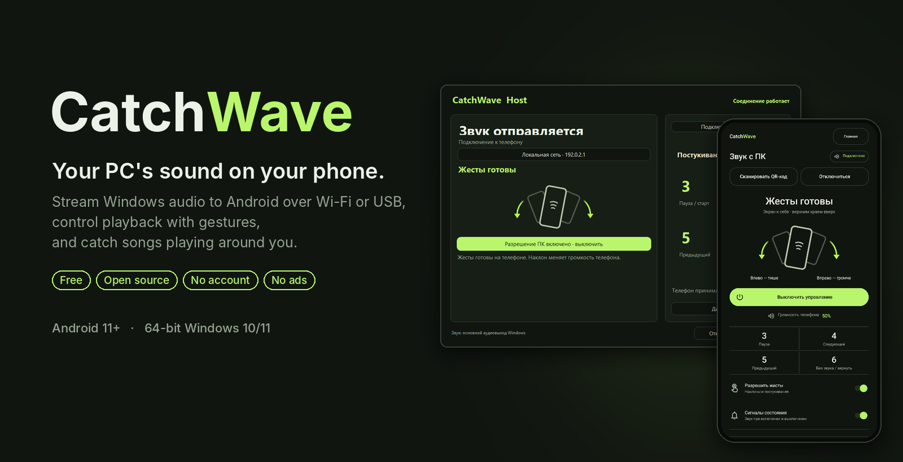
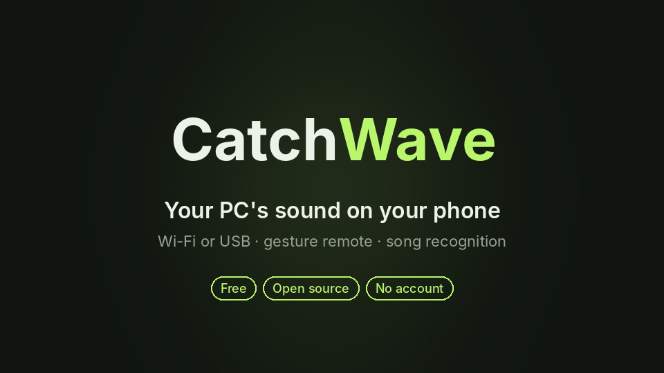
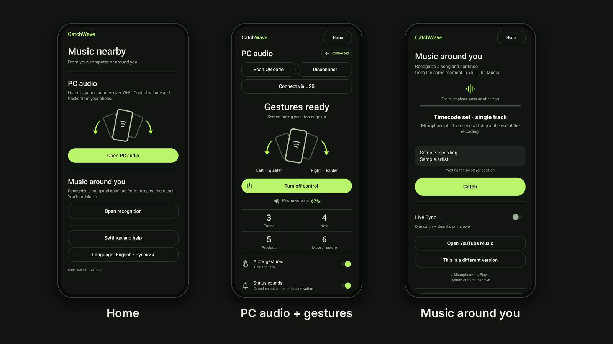
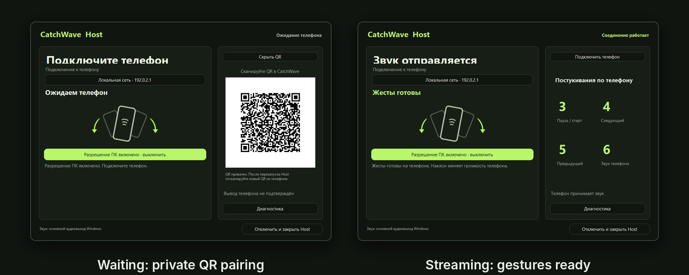
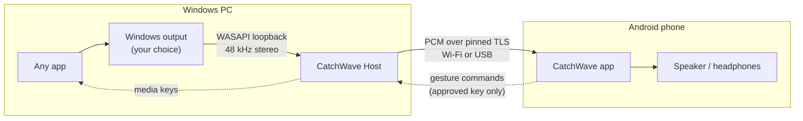

<p align="center">
  
</p>

<p align="center">
  <b>Your PC's sound on your phone.</b><br>
  Stream Windows audio to Android over Wi-Fi or USB, control playback with gestures, and catch songs playing around you.
</p>

<p align="center">
  <a href="https://github.com/BlackBadHope/CatchWave/releases/tag/v0.1.47-beta"></a>
  
  <a href="LICENSE.txt"></a>
  
  
</p>

---

CatchWave is a free, open-source companion that turns an Android phone into a wireless speaker and remote for your Windows PC. No account, no ads, no analytics, no subscription. It is a hobby project, built slowly and with a lot of care for the small things: an encrypted, pinned connection; audio that steps aside for your calls and videos; gestures with guards against accidental input; and a diagnostics view that never records your audio.

> **Beta.** CatchWave is tested on Windows 11 with a OnePlus 12 (Android 16). Other phones, Bluetooth outputs and long sessions still need testers. See [known limitations](KNOWN_ISSUES.md).

## See it in action

<p align="center">
  
</p>

## What it does

### 🔊 PC audio on your phone
- **Wi-Fi or cable.** It streams over your local network or through native USB (Android Open Accessory + WinUSB). No ADB, no USB tethering, no root.
- **Any Windows output.** You choose the output in the Host (speakers, monitor, headphones, or an existing virtual device) and can switch it during playback without reconnecting.
- **Zero setup for formats.** Windows converts whatever the output uses (up to 192 kHz, multichannel) to 48 kHz stereo for the phone.
- **Respects your phone.** A call or a video on the phone takes priority, and PC audio comes back afterwards. Notifications only lower the volume briefly.
- **Recovers on its own.** If the cable is pulled, the stream moves to the same paired PC over Wi-Fi.

### 👋 Gesture remote
Control the PC without unlocking anything. Activate control with one button, hold the phone still for 1.5 s, then:

| Gesture | Action |
| --- | --- |
| Tilt left / right and hold | Phone volume down / up |
| Shake, or 3 taps | Play / pause on the PC |
| 4 taps | Next track |
| 5 taps | Previous track |
| 6 taps | Mute / restore the phone |

Commands require a separate approval of the phone's key on the PC. A QR code grants audio only, never control.

### 🎵 Music around you
- **Recognize nearby music.** Hear a song in a café or on someone else's speaker: CatchWave fingerprints a short microphone sample on the phone and identifies it.
- **Continue in YouTube Music.** Playback opens in YouTube Music at the estimated moment of the song.
- **Live Sync** (with headphones) keeps the position aligned.
- **Music moments.** Every confirmed catch is kept in a private on-phone history: the song, the moment inside it and the time, with favorites, notes and shareable links. Nothing is uploaded.
- **Offline library.** Index your own music once, and songs from it are recognized entirely on the phone — no network, no third-party catalog. Unknown songs still fall back to the online catalog.

### 🔒 Private by design
- **Encrypted and pinned.** Audio and commands travel over TLS with the PC's certificate pinned by the QR scan.
- **No CatchWave server.** There is no backend, no account, no advertising ID and no analytics.
- **Nothing is installed behind your back.** The Windows Host is portable: no service, autostart, driver or firewall change for Wi-Fi use.
- **Diagnostics without your audio.** Diagnostics keep at most 256 metadata events locally, with no audio, QR codes or track titles.
- **Third parties, only where needed.** Recognition sends only the fingerprint to Shazam's catalog and searches YouTube; see [privacy](docs/PRIVACY.md).

## Screenshots

<p align="center">
  
</p>
<p align="center">
  
</p>

<sub>These pictures are the current English interface, including the Host status title at full height. The downloadable v0.1.47-beta package is still the older Russian build, so its windows do not match. Russian remains an in-app choice (immediate on the phone, next Host launch). The QR is an inert public fixture. The recognition screen shows the sample title “Sample recording”.</sub>

## Get started in 3 minutes

1. **Download** the phone app [CatchWave-Android-0.1.47-code72.apk](https://github.com/BlackBadHope/CatchWave/releases/download/v0.1.47-beta/CatchWave-Android-0.1.47-code72.apk) from the [0.1.47 beta](https://github.com/BlackBadHope/CatchWave/releases/tag/v0.1.47-beta). The Windows file on that page is still the old many-file zip. The current build is one `CatchWave.Host.exe`, or `CatchWave-Host-Setup.exe` when Inno Setup 6 is installed. Those files are not on the 0.1.47 page yet. Build them with `.\windows\build.ps1 -Package` (see below). Until then, the old zip still runs if you open only `CatchWave.Host.exe` and leave every other file in it alone.
2. **On the PC:** open `CatchWave-Host-Setup.exe` if you have it, then start **CatchWave Host** from the Start menu or the desktop. With only `CatchWave.Host.exe`, double-click that file. Windows may say it protected your PC, because this beta is unsigned. Choose **More info → Run anyway**. If Windows asks about networks, allow your home network only.
3. **On the phone:** open the APK. If Android blocks it, allow installs for the browser or Files app from that prompt, then install over any older CatchWave. Open **Open PC audio** (**«Открыть звук с ПК»** in the release build) → **Scan QR code**, scan the code on the PC and confirm.
4. *(Optional)* Approve the phone's key in the Host, turn on **Allow gestures** (**«Разрешить жесты»**) and press **Activate control** (**«Активировать управление»**).

Step-by-step guides:
- [Quick start for testers (Russian)](docs/BETA-START-RU.md)
- [LAN setup](docs/LAN-SETUP.md)
- [Native USB setup](docs/USB-SETUP.md)

> **Tip:** turn gesture control off when you don't need it. Picking up or putting down the phone can be read as a gesture.

## How it works



The Host captures the selected output with WASAPI loopback, cuts it into 20 ms frames and sends them over TLS. The phone plays them through `AudioTrack` and sends back gesture commands authenticated with its approved key. Details: [technical reference](docs/TECHNICAL.md).

## Requirements

| | Supported | Tested on |
| --- | --- | --- |
| Phone | Android 11 or newer, camera for QR pairing; accelerometer, gyroscope and rotation sensor for gestures | OnePlus 12, Android 16 |
| PC | Windows 10/11 x64. The packaged Host is one program and does not need a separate .NET install | Windows 11 x64 |
| Network | Phone and PC on the same trusted Wi-Fi/LAN, or a data USB cable | Home Wi-Fi, USB-C cable |

iOS, macOS and Linux hosts are not supported.

## Build from source

```powershell
# Android (JDK 17, Android SDK 36)
.\gradlew.bat --no-daemon :app:testReleaseUnitTest :app:lintRelease :app:assembleRelease
# Windows Host (.NET 9 SDK). -Validate is the test build.
.\windows\build.ps1 -Validate
.\windows\test-interop.ps1
# One self-contained exe for people to run. With Inno Setup 6.3+, also dist\CatchWave-Host-Setup.exe.
.\windows\build.ps1 -Package
```

`-Package` writes `dist\CatchWave-Host\CatchWave.Host.exe` plus plain English and Russian start notes. The shortcut and a double-click open the program with no extra flags. A separate .NET install is not required for that file.

Release APKs are signed separately; see the [signing policy](docs/ANDROID-SIGNING.md). More build notes are in the [technical reference](docs/TECHNICAL.md#build-and-verify).

## Feedback and contributing

Bug reports and test results from other phones are the most valuable help right now. Use the built-in **Diagnostics → Export** on both sides and describe what you did. Please never share your live QR code, keys or personal audio. See [CONTRIBUTING.md](CONTRIBUTING.md) and [public test status](docs/PUBLIC-TEST.md).

## License

CatchWave is free software under **GPL-3.0-or-later** ([LICENSE.txt](LICENSE.txt)).
- **Credits:** fingerprinting adapts SongRec via Audile; QR codes use ZXing and QRCoder. See [third-party notices](THIRD_PARTY_NOTICES.md) and [source provenance](SOURCE_PROVENANCE.txt).
- **Affiliation:** CatchWave is not affiliated with Google, YouTube, Apple, Shazam, SongRec, Audile or AudioRelay.

<p align="center"><sub>Made with care, and quite a few tokens. 💚</sub></p>
